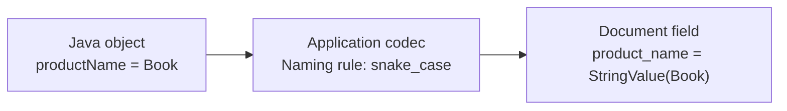
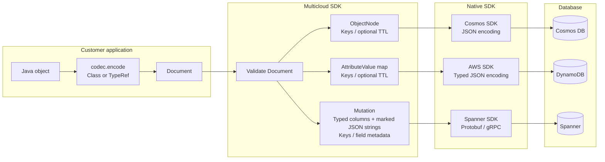
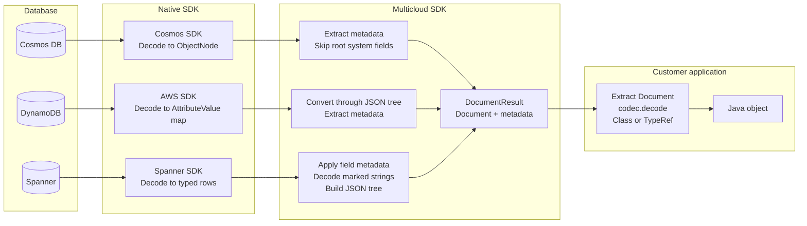
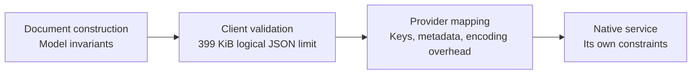
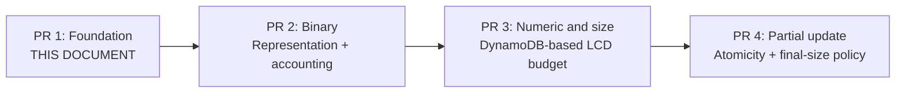

# Foundation: Document and Custom Mapping

**Scope: PR 1 only.** Follow-on PRs are listed at the end for context, not as part of this design.

**Application chooses the object mapping. Multicloud validates and maps the data. Native SDK sends it.**

## 1. What is Document?

An **immutable, typed object**, not JSON text or bytes. It supports null, boolean, string, number, array, and object. Missing fields differ from explicit null.

**Class structure** (simplified; constructors, validation, and other methods omitted):

```java
public final class Document {
    private final ObjectValue root;
    public ObjectValue root() { return root; }
}

public final class ObjectValue implements DocumentValue {
    private final Map<String, DocumentValue> fields;
    public Map<String, DocumentValue> fields() { return fields; }
}

public sealed interface DocumentValue permits
        NullValue, BooleanValue, StringValue,
        NumberValue, ArrayValue, ObjectValue {}

public final class NumberValue implements DocumentValue {
    private final Number value;
    public Number value() { return value; }
}
```

**Example instance**

```java
Document document = Document.builder()
        .put("product_name", new StringValue("Book"))
        .put("quantity", NumberValue.of(2))
        .put("shipping", ObjectValue.of(Map.of(
                "city", new StringValue("Seoul"))))
        .build();
```

**NumberValue is not "everything as double."** It retains the supplied `Byte`, `Short`, `Integer`, `Long`, `Float`, `Double`, `BigInteger`, or `BigDecimal`, subject to model bounds; NaN and infinity are rejected.

```java
NumberValue quantity = NumberValue.of(2);    // value() returns Integer
NumberValue count = NumberValue.of(2L);      // value() returns Long
NumberValue price = NumberValue.of(2.5d);    // value() returns Double
```

One numeric kind, multiple Java representations. Equality is mathematical (`2`, `2L`, and `2.0d` compare equal); retaining a representation in Document does **not** guarantee the same Java type after a database round trip.

## 2. How does custom mapping work?

Use the supplied **JacksonDocumentCodec** with application-configured naming, modules, and serializers, or implement **DocumentCodec** with another mapper.



```java
Document document = codec.encode(order, Order.class);
Order restored = codec.decode(document, Order.class);
```

The Jackson adapter uses in-memory tokens, not a JSON byte serialization/reparse cycle. Custom mapping controls business fields; **database keys and native types remain SDK-owned**.

**Serialization design rules**, informed by [Azure/azure-sdk-for-java#38997](https://github.com/Azure/azure-sdk-for-java/pull/38997):

| Rule | Our design |
|---|---|
| Neutral public boundary | Use typed, immutable Document rather than exposing Jackson or an unrestricted Map |
| Explicit customization | The app calls its codec; no SDK serializer registration or second application-mapping pass |
| Minimal intermediate conversion | Map Document directly to provider input; reuse native trees where safe, without sharing mutable state with Document |
| Validate after app mapping | Validate the resulting Document, not the original Java object; envelopes affect field paths, projections, partial updates, and size |

Application mapping does not replace native transport encoding or automatically rewrite queries/updates. New envelope, compression, or encryption features are not added by these rules.

## 3. End-to-end workflow

Boxes group responsibilities, not separate processes. The app invokes the codec explicitly, including the supplied Jackson adapter. Follow the selected provider branch, not all three.

**Write: application to database**



**Read: database to application**

The app calls `read(address, key)`. A found item's data returns through:



A missing read returns no document; handle it before decoding.

### Native input example

The same `quantity: 2` field becomes:

| Provider | Multicloud constructs | Native SDK encodes |
|---|---|---|
| **Cosmos** | ObjectNode containing `{"quantity": 2}` | JSON request |
| **DynamoDB** | AttributeValue: `N = "2"` | Typed DynamoDB JSON request |
| **Spanner** | Mutation binding: `quantity = INT64(2)` | Protobuf / gRPC request |

These are selected-field sketches; the SDK also supplies keys and metadata. ObjectNode is our Cosmos adapter's choice, not a Cosmos requirement. Spanner nested objects use marked JSON strings in compatible columns.

**Why ObjectNode?** Constructing the native input tree directly avoids a separate Document-to-Map-to-tree conversion before Cosmos SDK encoding. The current Cosmos SDK dependency is 4.82.0. This is an internal optimization, not a zero-copy or universal performance guarantee; no dependency on Cosmos internal wrapper classes is required.

## 4. Size and value guarantees

**Check what is known from Document before building provider input.**



| Boundary | What it establishes |
|---|---|
| **Document** | Immutable values; valid root/types/depth/model number bounds; missing differs from null |
| **Logical size** | At most **399 KiB = 408,576 bytes**, counted without creating JSON bytes |
| **Provider and service** | Native schema, type, and size constraints; passing the logical check does **not** guarantee native fit |

**Follow-on size direction (PR 3): DynamoDB-based portable item-size budget.** Use DynamoDB's **400 KiB = 409,600 bytes** item limit as the lowest-common-denominator (LCD) size policy for every provider, not predicted physical storage. Count the DynamoDB-equivalent item, including attribute names, values, nested structure overhead, and SDK-added keys/TTL.

The check can traverse **Document + keys + write options** before native mapping, without constructing AttributeValue objects or JSON bytes. Binary uses raw-byte accounting; approximate numeric accounting needs a defined conservative rule and margin. These details remain to be finalized; **PR 1 retains its existing 399 KiB logical JSON check**.

Cosmos backend encoding savings do not increase this common budget. Mapping compatibility with Cosmos/Spanner constraints still needs verification; DynamoDB fit alone is not proof of every native constraint. Model number support/equality does not guarantee identical database precision, scale, or arithmetic.

**Not guaranteed by PR 1:** comprehensive native-size prechecks, an expanded portable numeric domain, or a common final-document limit after partial updates. An update's input size is not its resulting document size.

## 5. Delivery plan



**PR 1:** Document, custom codecs, optional Jackson, validation, and provider integration. Each PR includes its own tests, documentation, and changelogs.

Future review: PR 2 - Binary, PR 3 - Numeric and Size, PR 4 - Partial Update. The LCD size direction is selected; remaining accounting, numeric, binary, and partial-update details require separate agreement.

*Design summary, not a released-support guarantee.*
